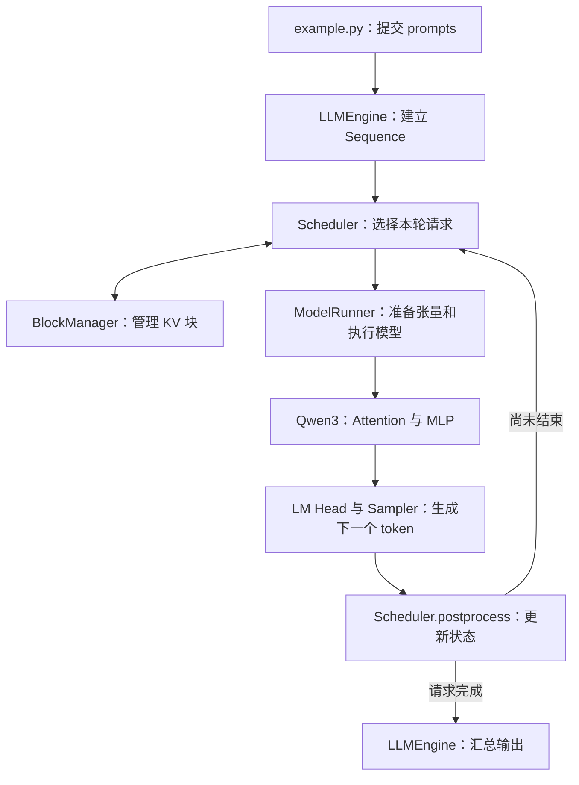

# 从大模型应用算法到 AI Infra：基于 Nano-vLLM 的入门计划

本计划依据当前仓库代码（提交 `bb823b3`）制定。默认你熟悉 Python、Transformer 和模型应用，但尚未系统学习 GPU 执行、推理调度和显存管理。按每周 8～10 小时、共 12 周安排；如果每周只有 4～5 小时，可以把每周内容拆成两周。完成时间服从验收结果。

## 1. 先明确学习方向和终点

建议先选择 **LLM 推理引擎与性能优化** 作为 AI Infra 的切入方向。你已有的模型知识可以直接用于理解推理行为，Nano-vLLM 则补上从“调用模型”到“组织模型执行”的部分。

AI Infra 还包括训练系统、算子与编译器、分布式通信、资源调度和服务平台。本项目主要覆盖推理引擎，不能替代这些方向的全部训练。第一阶段不必同时展开 Kubernetes、完整 CUDA C++ 开发、分布式训练和编译器课程。

12 周后的目标是：

- 能从请求进入到生成结束，讲清楚引擎中的调用链、张量流和状态变化。
- 能解释 Prefill、Decode、KV Cache、连续批处理、前缀缓存和张量并行各自解决的问题。
- 能建立可复现的实验，区分延迟、吞吐、显存和正确性，依据测量判断瓶颈。
- 能独立完成一个有测试、有测量、有结论的小型推理系统改进，并整理成作品。

这代表具备推理 Infra 入门能力；是否达到目标岗位要求，还需结合岗位方向补足工程经验。

## 2. 理解项目的最短路径

初读时，沿着一个请求前进。遇到不熟悉的底层实现，先记录输入、输出和职责，再继续主链路。



| 阅读顺序 | 代码入口 | 先回答的问题 |
| --- | --- | --- |
| 1 | [example.py](../example.py)、[sampling_params.py](../nanovllm/sampling_params.py)、[config.py](../nanovllm/config.py) | 调用者提供什么？哪些参数限制生成和资源？ |
| 2 | [llm_engine.py](../nanovllm/engine/llm_engine.py)：`generate / add_request / step` | 一次生成为什么要循环执行多个 step？ |
| 3 | [sequence.py](../nanovllm/engine/sequence.py) | 请求携带哪些状态？哪些 token 已计算 KV，哪些只是刚被采样？ |
| 4 | [scheduler.py](../nanovllm/engine/scheduler.py) | 下一轮处理谁？什么时候做 Prefill、Decode、抢占？ |
| 5 | [model_runner.py](../nanovllm/engine/model_runner.py)：`prepare_prefill / prepare_decode / run` | Python 请求对象如何变成 GPU 输入？ |
| 6 | [qwen3.py](../nanovllm/models/qwen3.py)、[attention.py](../nanovllm/layers/attention.py) | 模型层如何读写 KV Cache？ |
| 7 | [block_manager.py](../nanovllm/engine/block_manager.py) | token 的逻辑位置如何映射到物理显存块？ |
| 8 | [layernorm.py](../nanovllm/layers/layernorm.py)、[linear.py](../nanovllm/layers/linear.py)、[embed_head.py](../nanovllm/layers/embed_head.py) | 编译、算子融合和多卡切分分别发生在哪里？ |

第一次读 `ModelRunner` 时先略过 CUDA Graph、共享内存通信和多卡分支；第 8～10 周再回来看。`nanovllm/llm.py` 本身只是 `LLMEngine` 的简单子类，核心逻辑在 engine 目录。

## 3. 环境与学习方式

**运行环境。** 当前实现直接使用 CUDA、NCCL、Triton 和 FlashAttention，包括单卡路径也初始化 NCCL。完整推理实验按 Linux + 受所选依赖版本支持的 NVIDIA GPU 准备；Mac 可以用于读代码、画图和 CPU 小实验，但不能直接运行这套 CUDA 引擎。

建议从 Qwen3-0.6B 和单卡开始。README 提供过 8 GB 显卡上的测量，说明小模型实验可以在有限资源上开展，但显存需求仍受版本、上下文长度、并发和初始化配置影响；有条件时 16 GB 以上更宽松。双卡只在第 10 周需要，不作为前面阶段的门槛。

**软件环境。** `pyproject.toml` 要求 Python `>=3.10,<3.13`，可优先用 3.11。先匹配 GPU、驱动、PyTorch CUDA 构建和 FlashAttention 的支持条件，安装成功后记录完整版本。依赖文件给出的下限不等于所有版本组合都兼容。

在已经准备好的独立 GPU 环境中，使用本地仓库安装方式 `python -m pip install -e .`，方便后续修改生效；PyTorch 和 FlashAttention 的安装顺序及构建参数以所选环境为准。模型下载可参考 README，下载后确认权重和 tokenizer 文件齐全。

第一次运行可在单独的学习脚本中使用以下配置，`model_path` 替换为模型所在目录：

```python
from nanovllm import LLM, SamplingParams

llm = LLM(
    model_path,
    enforce_eager=True,
    tensor_parallel_size=1,
    max_model_len=1024,
    max_num_batched_tokens=512,
    max_num_seqs=8,
    gpu_memory_utilization=0.75,
)
outputs = llm.generate(
    ["Hello, my name is"],
    SamplingParams(temperature=0.6, max_tokens=16),
)
print(outputs)
```

这只是起步配置，不是性能最优配置。实验时主动保证输入与计划输出总长度不超过设置的上下文范围。学习脚本保留 `example.py` 的 `if __name__ == "__main__":` 入口，便于后续使用多进程。

**没有 GPU 时。** 可先完成源码追踪、手工调度、显存估算、纯 PyTorch CPU 的注意力实验和独立的 Python 块管理模拟。GPU 跑通、性能测量和 Triton 实验仍需后续补做。注意包的 `__init__.py` 会导入引擎，直接导入其中某个类也可能触发 GPU 依赖；CPU 练习先写独立最小实现。

**每周节奏。** 概念学习约 2 小时，源码阅读约 2 小时，实验约 3～4 小时，笔记与验收约 1～2 小时。每周至少留下一个可展示的产物：图、脚本、测试或实验报告。记录“我的预测—实际结果—解释—仍不确定的地方”。

## 4. 12 周执行计划

### 第 1 周：跑通模型，建立一次生成的全貌

配套材料：[完整学习文档](week01/learning-guide.md)、[源码分析文档](week01/source-analysis.md)、[单请求/双请求观察脚本](week01/observe.py)。建议先按学习文档的七天安排执行，再用源码分析核对实验中的状态变化。

**学习重点：** token、logits、自回归生成；CPU 与 GPU 分工；显存、进程、CUDA 的基本含义。熟悉的模型基础可以快速跳过。

**源码：** `example.py` → `LLMEngine.generate` → `add_request` → `step`，辅以 `Config` 和 `SamplingParams`。

**任务：**

1. 建立环境记录：代码提交、操作系统、GPU 型号/显存、驱动、Python、PyTorch/CUDA、Triton、FlashAttention、Transformers 版本及模型版本。
2. 跑通一个短 prompt，再跑两个不同长度的 prompt；先用单卡、关闭 CUDA Graph、少量输出。
3. 画出调用链，解释 `generate` 循环结束的条件。
4. 观察运行前后显存和耗时，区分加载/编译/预热时间与生成时间。暂不以 README 的吞吐为目标。

**验收：** 能从 `generate` 一直定位到模型执行；能解释为什么初始化可能明显慢于后续生成；保存运行记录和一张调用图。

### 第 2 周：追踪张量，理解 Prefill 和 Decode

**学习重点：** 张量 shape、dtype、device、stride；Prefill 是处理输入上下文，Decode 是利用已有上下文继续逐 token 生成。

**源码：** `Sequence`、`ModelRunner.prepare_prefill / prepare_decode`、`Qwen3Attention.forward`、`Context`、`ParallelLMHead.forward`。

**任务：**

1. 用两个长度不同的请求，记录首次 Prefill 和随后两个 Decode step 的 `input_ids`、`positions`、`cu_seqlens_q`、`context_lens`。
2. 给 Q、K、V 写出 shape。单卡时，Q 形如 `[本轮 token 数, 查询头数, head_dim]`，K/V 使用 KV 头数；不要把 GQA 的 KV 头数误当成查询头数。
3. 解释 Prefill 如何把不同长度请求拼成扁平 token 数组，以及 Decode 为什么通常每条序列只输入一个 token。
4. 从 `ParallelLMHead` 找到 Prefill 取每个序列本轮最后位置的逻辑。

**验收：** 独立画出 Prefill 与 Decode 的张量变化，并解释“本轮输入一个 token”为什么不等于“只关注一个 token”。

### 第 3 周：自己实现一个最小 KV Cache

**学习重点：** 因果注意力、缓存历史 K/V 的原因、GQA、KV 显存估算。

**源码：** `Attention.forward`、`ModelRunner.allocate_kv_cache`、`Qwen3Attention`。

**任务：**

1. 在独立的小型 PyTorch 脚本里，用固定权重和固定输入实现单层因果注意力。
2. 对照“每一步重算整个前缀”与“只计算新 token 的 Q/K/V 并追加 KV Cache”，比较每个位置的输出。先在 CPU 上验证数值正确性。
3. 从模型配置读取层数、KV 头数、head_dim 和 dtype，估算一条序列的 KV 显存，再核对项目的 `block_bytes` 计算。

单卡、同长度序列、不考虑块取整及共享时：

```text
KV 字节数 ≈ 2 × 层数 × 序列数 × 每条序列已缓存 token 数
             × KV 头数 × head_dim × 每元素字节数
```

系数 2 对应 K 和 V。不同长度时用各序列缓存长度之和；块分配需要向上取整；前缀共享按不同的物理块计算。本项目在满足整除条件时将 KV 头按 TP 切分，单卡估算使用该卡的 KV 头数。

**验收：** 最小实现通过数值对照；能够估算上下文长度或并发翻倍的显存影响，并说明这不包含权重、临时张量和 CUDA Graph 等其他开销。

### 第 4 周：理解调度与连续批处理

**学习重点：** 请求队列、状态机、token 预算、连续批处理、抢占与重算。

**源码：** `Scheduler.schedule / postprocess / preempt`、`SequenceStatus`、`LLMEngine.step`。

**任务：**

1. 手工推演三个请求，输出长度分别设为 2、4、8；逐轮记录 waiting、running、完成请求和所选阶段。
2. 在学习脚本里使用 `add_request` 和 `step`，在旧请求尚未完成时加入新请求，观察运行批次如何变化。
3. 调整 `max_num_seqs` 与 `max_num_batched_tokens`，解释二者分别约束什么。
4. 在独立模拟器中减少可用块，复现请求被抢占后回到等待队列的过程，避免一开始用真实 OOM 调试状态机。

**验收：** 用一张逐轮调度表解释请求加入、退出和抢占；能指出本版本会优先处理可调度的 Prefill，持续新请求可能影响已有请求的 Decode 延迟。

### 第 5 周：理解 KV Cache 的块管理

**学习重点：** 逻辑块、物理块、块表、空闲列表、引用计数、尾块未使用空间。

**源码：** `BlockManager`、`Sequence.num_blocks / block`、`prepare_block_tables`、`prepare_decode` 的 `slot_mapping`。

**任务：**

1. 写一个独立的 Python 块管理模拟器。教学模拟可使用每块 4 个 token；真实引擎继续使用其支持的块大小，不直接把运行配置改成 4。
2. 演示三条不同长度序列如何分配、增长、释放物理块。
3. 手算一个 token 的物理位置：`slot = 物理块编号 × block_size + 块内偏移`，与 `slot_mapping` 对照。
4. 为模拟器覆盖跨块追加、释放后复用、共享引用不被提前释放等行为。

**验收：** 能画出逻辑连续而物理不连续的 KV 布局，说明分页能减轻连续分配和碎片问题，但不减少每个 token 的 K/V 数据本身。

### 第 6 周：前缀缓存与分块 Prefill

**学习重点：** 完整块复用、前缀哈希链、缓存命中、分块执行与调度取舍。

**源码：** `compute_hash / can_allocate / allocate / hash_blocks`，以及 `Scheduler.schedule / postprocess` 中 `num_cached_tokens` 和 `num_scheduled_tokens` 的变化。

**任务：**

1. 构造共享至少两个完整块前缀的输入，比较独立运行时的首次请求和同一引擎后续请求。先使用明确的 token IDs，避免把文本前缀相同误当成分词结果必然一致。
2. 记录复用 token 数、本轮新计算 token 数和耗时；构造首块就不同的输入作为对照。
3. 将 prompt 设为超过本轮 token 预算、但仍在上下文上限内，追踪它如何分多轮完成 Prefill。
4. 检查中间分块产生的采样结果为什么不会被追加到序列；找到真正产生第一个输出 token 的时刻。

**验收：** 解释哈希为什么包含前面块的信息，以及为什么当前 `can_allocate` 不复用序列的最后一个逻辑块；能用轨迹说明本版本的分块 Prefill 行为。

需要核对的实现边界：当前代码仅允许本轮选中的第一个序列发生部分 Prefill；每轮返回的是 Prefill 批或 Decode 批。它不会在同一批中混合两者，也没有实现通用的公平交错调度。此外，首次分配会为当前序列分配所需的整组块，分块执行不等于按分块渐进分配 KV 显存。

### 第 7 周：建立可信的基准与性能分析

**学习重点：** 延迟与吞吐、GPU 异步执行、预热、CPU 调度开销、显存带宽与计算瓶颈。

**源码：** `bench.py`、`LLMEngine.step`、`ModelRunner.run`。工具先学 `nvidia-smi`、PyTorch Profiler 和 CUDA Event；Nsight Systems 可按需补充。

**任务：**

1. 保留原始 `bench.py` 作为参考，写自己的小型基准入口，固定输入、输出上限和配置。
2. 至少覆盖短输入/长输入、短输出/长输出、少请求/多请求几组负载；先逐项改变变量，不做大规模组合扫描。
3. 分别统计整体吞吐、请求延迟、实际输出 token 数和显存。使用第 9 节的统一口径。
4. 取一小段 Profiler 轨迹，找出耗时最多的操作，以及 CPU 发射与 GPU 执行之间的空隙。正式计时关闭详细日志和 Profiler。

**验收：** 给出一个有测量依据的瓶颈判断，能区分“观测到的现象”和“尚需验证的原因”。没有测量就不宣称某项优化有效。

### 第 8 周：CUDA Graph 与 torch.compile

**学习重点：** kernel 启动开销、图捕获/重放、固定地址缓冲区、批大小分档、编译与算子融合。

**源码：** `capture_cudagraph / run_model`，以及 `RMSNorm`、`SiluAndMul`、`Sampler` 和 RoPE 中的 `torch.compile`。

**任务：**

1. 在相同硬件与请求下比较 `enforce_eager=True / False`；分别预热，分别记录初始化与稳定运行耗时。
2. 选一个较小批次和一个较大批次，解释 CUDA Graph 收益为何可能不同。
3. 追踪实际批大小如何选择图档位，以及 `slot_mapping=-1` 的填充项如何避免写入 KV Cache。
4. 单独取一个小算子，对照普通 PyTorch 实现与编译实现的结果和稳定运行时间，编译耗时单独记录。

**验收：** 能准确解释 `enforce_eager=True` 在本项目只跳过 CUDA Graph；它不会自动去掉各层的 `torch.compile`。因此两种配置的对比不能命名为“完全未编译 vs 编译”。

### 第 9 周：通过 KV 写入算子入门 Triton

**学习重点：** GPU 并行程序实例、索引计算、连续访存、stride、掩码与越界保护；此时再补相应 GPU 基础。

**源码：** `store_kvcache_kernel / store_kvcache`。

**任务：**

1. 逐行解释一个 Triton program 负责哪个 token，如何定位该 token 的 K/V 和目标缓存位置。
2. 写一个简单 PyTorch 索引写入版本作为正确性参考；有效槽位使用互不冲突的目标位置。
3. 验证不同 token 数、非连续输入步长和 `slot=-1` 情况下的结果。测试形状先保持在原内核支持范围内。
4. 用 GPU 计时比较内核耗时，解释小规模调用时启动开销的影响。

**验收：** 能独立解释索引与内存布局，正确性对照通过。若扩展不规则维度，需要自行设计 padding/mask；本周不要求重写 FlashAttention。

### 第 10 周：张量并行与通信

**学习重点：** 按输入/输出维度切分矩阵、AllReduce、Gather、rank/world_size、计算与通信的取舍。

**源码：** `ColumnParallelLinear / RowParallelLinear / QKVParallelLinear`、`VocabParallelEmbedding / ParallelLMHead`、`load_model`、`ModelRunner` 的多进程通信。

**任务：**

1. 先用 CPU 小矩阵模拟两个分片，验证列切分后拼接、行切分后求和与原始线性层结果一致。注意 PyTorch 权重布局是 `[out_features, in_features]`。
2. 画出 QKV、注意力输出投影、MLP、Embedding 和 LM Head 在两张卡上的数据流，标出通信位置。
3. 有双卡时比较 TP=1 和 TP=2，并记录通信/显存/吞吐。先检查模型头数、KV 头数和词表等整除要求。
4. 解释共享内存与 Event 传递的控制信息，和 NCCL 传输的张量数据分别是什么。

**验收：** 能用矩阵公式解释 AllReduce 的必要性；能解释小模型增加卡数可能更慢。没有双卡时完成模拟并注明“未完成多 GPU 实测”，后续补做。

### 第 11 周：补上可观测性和正确性保障

**学习重点：** 指标口径、请求生命周期、边界输入、回归测试、可复现性。

**任务：**

1. 在学习分支记录请求进入、首个实际输出 token 和完成的时间；只在 token 真正追加时记输出事件，避免把分块 Prefill 的中间采样计入输出。
2. 记录 waiting/running 数量、缓存复用 token 数、空闲块数、抢占次数，观察它们与延迟的关系。
3. 为自己修改到的逻辑补关键行为测试，优先覆盖块边界、共享块释放、EOS 与输出上限等路径。
4. 同一套固定输入用于改动前后对照；纯算子先比较数值误差，引擎还要检查请求是否完成、输出数量和资源回收是否正确。

**验收：** 产生一份带指标定义的测量结果，并能区分数值误差、随机采样差异和真实逻辑错误。固定随机种子有帮助，但不能保证不同并行配置的生成文本完全一致。

### 第 12 周：完成一个可展示的项目

推荐必做作品：**Nano-vLLM 推理性能与 KV Cache 行为分析工具**。

基础范围控制在：可配置负载、结构化指标、前缀复用实验、CUDA Graph 对照，以及一份解释瓶颈的报告。如果前面进展顺利，再从测量发现中选择一个小改进，例如减少一处确认存在的 Python 数据整理开销，或修复一个可复现的边界问题。

交付内容：

- 可复现的运行说明、依赖版本和参数记录。
- 实验脚本、原始数据、必要的正确性测试。
- 至少三组有明确对照的实验，包含一次没有收益或收益有限的情况。
- 一份报告：问题 → 假设 → 实验设计 → 结果 → 原因分析 → 适用边界。
- 一次 10 分钟讲解：请求链路、核心机制、证据和结论。

**验收：** 其他工程师能按说明复现；你能解释改变了什么、为什么这样改、何种负载下有效。优化没有收益也可以成为合格结论，不能把未经实测的推断写成性能提升。

## 5. 第一周可以直接照做的安排

| 时间 | 任务 | 当天产物 |
| --- | --- | --- |
| 第 1 天，1 小时 | 读 README、配置和示例；理解 Prefill/Decode 的基本含义 | 术语表和调用链草图 |
| 第 2 天，1.5 小时 | 检查 GPU 环境、准备依赖和小模型 | 环境记录；尚未跑通则记录具体报错 |
| 第 3 天，1 小时 | 完成单请求，再完成双请求推理 | 两次运行记录 |
| 第 4 天，1 小时 | 追踪 `generate / add_request / step` | 每个函数的一句话职责 |
| 第 5 天，1 小时 | 读 `Sequence`，追踪 prompt 与输出 token 数变化 | 一个请求的状态表 |
| 第 6 天，2 小时 | 手工追踪 Prefill 和两个 Decode step | 调用图与变量变化记录 |
| 第 7 天，1 小时 | 复述原理、整理问题、对照验收 | 一页学习笔记 |

环境排障若超过预算，保留准确报错，继续可独立完成的源码和 CPU 练习；GPU 跑通作为待完成项。不要让安装问题消耗整周而没有任何学习产物。

## 6. 先掌握这些术语

| 术语 | 在本项目中的含义 |
| --- | --- |
| Prefill | 处理 prompt 中本轮需要计算的部分，生成对应的 KV；完成整个 prompt 后产生第一个输出 token |
| Decode | 输入上轮生成的 token，读取历史 KV，产生下一个 token |
| KV Cache | 保存各层历史 token 的 Key/Value，避免逐步生成时重复计算它们 |
| 连续批处理 | 在迭代边界让请求进入或退出运行集合，从而提高资源利用率 |
| 分页 KV 管理 | 将每条序列的逻辑 token 区间映射到可复用的物理块 |
| 前缀缓存 | 复用相同 token 前缀对应的已计算 KV 块，减少 Prefill 工作量 |
| CUDA Graph | 捕获并重放一组 GPU 操作，减少重复提交工作的开销 |
| 张量并行（TP） | 将同一层的计算/权重切分到多张 GPU，并通过通信组合结果 |
| 计算受限 / 带宽受限 | 主要受算力或数据搬运速度限制；需要结合负载与实际测量判断 |

Prefill 往往更容易形成较大的矩阵运算；小批量 Decode 常受权重/KV 读取与启动开销影响。它们是分析起点，不是对所有模型和负载都成立的固定结论。

## 7. 当前实现中容易误读的地方

1. **它主要是离线推理引擎。** `generate` 会等待完成后返回结果，没有现成的 HTTP 服务、客户端流式输出、在线压测和生产监控。
2. **`bench.py` 主要度量整体输出吞吐。** 它使用随机 token 输入和指定输出长度；进度条上的 Prefill/Decode 速率也不等于请求的 TTFT 或 TPOT。
3. **当前版本已经实现简化的分块 Prefill。** 学习时应先复现，再讨论调度改进，不能把“从零加入分块”当作已有版本缺失的功能。
4. **分页管理和 Attention 内核是两个层面。** Python 负责块管理，FlashAttention 提供核心注意力计算，仓库中的 Triton 内核负责 KV 写入。读完本项目不等于实现了 FlashAttention。
5. **前缀命中受块边界和实现策略影响。** 相同短文本未必命中完整块；最后一个逻辑块会留给计算。释放序列也不等于立即清空所有可复用缓存内容。
6. **`temperature=0` 不能用于本项目的贪心对照。** `SamplingParams` 明确禁止这种设置。正确性实验应比较确定性张量输出，或先单独实现并验证明确的贪心路径。
7. **显存占用不能直接等同于活跃请求 KV 使用量。** 引擎会按预算预分配 KV 池，减少活跃请求不一定明显降低 `nvidia-smi` 数字；块使用率需要单独统计。

## 8. 补基础和查资料的顺序

资料按遇到的问题选读，每周最多增加一两份。以下是参考入口，并非已经为某个具体软件版本验证的安装教程。

| 阶段 | 推荐材料 | 阅读目标 |
| --- | --- | --- |
| 第 1～3 周 | PyTorch Tensor 文档、[CUDA semantics](https://docs.pytorch.org/docs/stable/notes/cuda.html) | 理解 shape/stride、device、异步执行与同步 |
| 第 3～6 周 | vLLM 的 PagedAttention 论文《Efficient Memory Management for Large Language Model Serving with PagedAttention》、[vLLM 文档](https://docs.vllm.ai/) | 对照理解分页、共享和调度；区分论文/完整引擎与本项目的范围 |
| 第 7～8 周 | [PyTorch Profiler 教程](https://docs.pytorch.org/tutorials/recipes/recipes/profiler_recipe.html)、PyTorch CUDA Graph 与 `torch.compile` 文档 | 会读轨迹，理解启动开销和编译行为 |
| 第 9 周 | [Triton 官方教程](https://triton-lang.org/main/getting-started/tutorials/index.html)中的 Vector Addition | 学会最小内核和索引，再回到 KV 写入 |
| 第 9 周后按需 | FlashAttention 论文 | 理解注意力计算中的显存访问成本与分块思想 |
| 第 10 周 | [PyTorch Distributed](https://docs.pytorch.org/docs/stable/distributed.html)、Megatron-LM 的张量并行说明 | 用矩阵切分解释 collective 通信 |

Linux 的 SSH、进程和显存观察、虚拟环境、Git diff 与基本测试伴随项目学习。GPU 线程层级和存储层级在读 Triton 时补；完整 C++、CUDA 优化和编译器体系留到方向明确后深入。

## 9. 统一实验口径

| 指标 | 定义与注意事项 |
| --- | --- |
| 输出吞吐 | 全部请求实际生成的输出 token 总数 ÷ 测量墙钟时间；说明是否包含排队、初始化、预热 |
| 请求端到端延迟 | 从请求进入测量系统到其最后一个输出 token 产生/交付的时间；声明测量边界 |
| TTFT | 首个实际输出 token 的时间 − 请求到达时间；包含该边界内的排队与 Prefill |
| TPOT | 输出数 N > 1 时，`(最后一个输出时间 − 第一个输出时间) / (N − 1)`；N=1 不计算 |
| token 间隔 | 相邻输出 token 的时间差；与平均 TPOT 不同，可用于观察生成停顿 |
| 显存 | 区分设备总占用、PyTorch allocated/reserved、预分配 KV 池与实际活跃块 |
| 前缀命中 | 明确定义复用 token 数/总输入 token 数等口径；不要只报告“命中请求占比” |

本项目需要增加内部事件记录才能得到请求级 TTFT 和 TPOT；`step` 原本只向上返回已完成请求。内部记录得到的是引擎内的时间，不包含真实网络传输和客户端显示开销。

实验规则：

- 固定模型、代码、软件环境、dtype、输入集合、采样设置与硬件；每次只改变目标变量。
- 初始化、编译、图捕获和预热单独记录；稳定性能至少重复三次，报告中位数及波动。p95 等尾延迟需要足够请求样本。
- 微基准使用 CUDA Event 或在计时边界同步；不要用未经同步的 CPU 时间判断异步 GPU 算子时长。测量完整请求时保留真实排队与数据整理成本。
- 区分冷前缀缓存和热前缀缓存；重复同一输入可能意外改变缓存命中率。冷缓存实验可用独立引擎并以不重叠输入完成算子预热。
- 明确负载方式：一次提交全部请求是离线积压负载，按时间到达的新请求是在线负载。二者的延迟不能直接混在一起比较。
- 性能测试可使用 `ignore_eos=True` 固定输出工作量；正确性与正常使用场景另测 EOS 行为。实际输出数量仍要核对。
- 原始 `bench.py` 的参考数字只代表它记录的环境和负载，不能当作自己硬件的预期保证。

建议每次报告记录以下字段：

```text
代码提交 / 模型版本 / GPU 与软件版本
请求数 / 输入长度分布 / 输出设置 / 到达方式
max_num_seqs / max_num_batched_tokens / max_model_len
TP / CUDA Graph 开关 / 前缀冷或热 / 预热方式
实际输入和输出 token 数 / 测量时间 / 吞吐
可用时：TTFT / TPOT / 请求延迟 / 显存 / 活跃块 / 抢占数
重复次数 / 波动 / 正确性验证 / 结论适用范围
```

## 10. 何时进入下一阶段

- **第 3 周结束：** 不看资料也能解释 Prefill、Decode 和 KV Cache，并完成最小缓存实现。
- **第 6 周结束：** 能推演请求调度和块生命周期，解释前缀共享与分块的边界。
- **第 9 周结束：** 能做可信性能测量，读懂一个 Triton 内核，并解释 CUDA Graph 与编译的区别。
- **第 12 周结束：** 有可复现作品，能在代码和测量证据上回答问题。

某一节点没有完成，就补相应实践，不用靠增加资料阅读来代替验收。

完成后，若继续走推理系统方向，选择 vLLM 或 SGLang 中一个对应模块深入，并补在线服务、排队与尾延迟、取消/超时、监控和负载测试；若偏 GPU 性能，继续学习 CUDA C++、Triton、Roofline 和 Nsight；若转向训练 Infra，再展开 DDP、FSDP/ZeRO、优化器状态与 checkpoint。

为转岗准备的项目描述应包含真实工作负载、测量口径和结果。可以先使用模板：“基于 Nano-vLLM 实现了……，在……模型/硬件/负载下，通过……验证……；限制是……”，实验完成后再填入数据。
