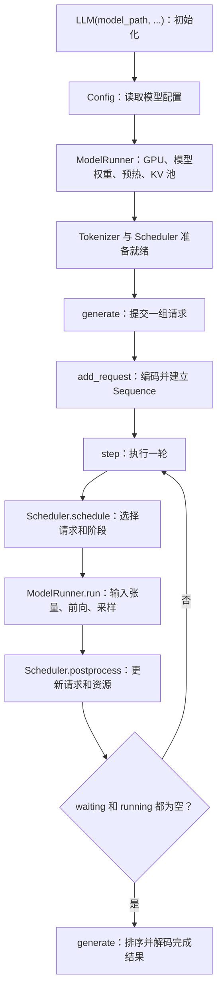

# 第一周分析文档：一次生成请求如何穿过 Nano-vLLM

本文依据仓库提交 `cb37cd0` 的源码，配合[学习文档](learning-guide.md)和[观察脚本](observe.py)使用。阅读目标是理解单卡请求主流程；源码摘录会明确标注省略或伪代码，手工 token 示例不代表真实模型运行结果。

## 1. 先把整个系统分成两条链路

第一条是初始化：准备一个可执行推理的引擎。第二条是生成：让一个或多个请求反复经过调度和模型执行，直到结束。



初始化一次后，正常顺序调用可以多次生成。每次创建新的 `LLM(...)` 则会重新初始化相关资源。学习脚本的每次命令启动独立进程，因此分别支付初始化成本。

### 1.1 四个核心对象

| 对象 | 管理的内容 | 一句话职责 |
| --- | --- | --- |
| `LLMEngine` | tokenizer、scheduler、model_runner、执行循环 | 串联请求的整个生命周期 |
| `Sequence` | token IDs、长度、状态、采样设置、块表 | 保存一条请求的进展 |
| `Scheduler` | waiting/running 队列、资源分配决策 | 决定这一轮处理谁，以及如何更新进展 |
| `ModelRunner` | GPU 模型、KV 张量、张量准备与模型执行 | 将本轮请求转成计算，返回采样 token |

`BlockManager` 是调度器使用的 KV 块管理组件，本周先理解它维护分配和释放关系，后续再深入块共享与哈希。

### 1.2 CPU 与 GPU 的分工

| 内容 | 主要位置 | 说明 |
| --- | --- | --- |
| 字符串和 token ID 的 Python 列表 | CPU | tokenizer、请求对象和输出整理使用 |
| waiting/running、状态、块编号列表 | CPU | 由 Python 逻辑管理 |
| `input_ids`、`positions` 等执行张量 | 构造后传至 GPU | `prepare_prefill / prepare_decode` 负责准备 |
| 模型权重、KV Cache、前向中间张量 | GPU | 模型计算和注意力读取使用 |
| 采样后的 token IDs | GPU 计算，复制回 CPU 列表 | `Sampler(...).tolist()` 返回给调度逻辑 |

块编号列表在 CPU，不代表 KV 内容也在 CPU。`block_table` 是“到哪里找数据”的元数据，KV 张量是实际数据。

## 2. 源码导航：每个文件承担什么

| 文件 | 第一周阅读位置 | 阅读深度 |
| --- | --- | --- |
| [example.py](../../example.py) | `main` | 完整阅读 |
| [nanovllm/__init__.py](../../nanovllm/__init__.py) | 导出对象 | 完整阅读 |
| [llm.py](../../nanovllm/llm.py) | `LLM` | 完整阅读 |
| [config.py](../../nanovllm/config.py) | `Config` | 理解起步参数 |
| [sampling_params.py](../../nanovllm/sampling_params.py) | `SamplingParams` | 完整阅读 |
| [llm_engine.py](../../nanovllm/engine/llm_engine.py) | 初始化、`add_request / step / generate / is_finished` | 本周核心，完整阅读 |
| [sequence.py](../../nanovllm/engine/sequence.py) | 初始化、属性、`append_token` | 本周核心；序列化留到多卡章节 |
| [scheduler.py](../../nanovllm/engine/scheduler.py) | `add / schedule / postprocess / is_finished` | 读懂正常路径；抢占先认识用途 |
| [model_runner.py](../../nanovllm/engine/model_runner.py) | 初始化、`call / run / prepare_prefill / prepare_decode` | 理解输入输出；图捕获和多卡循环后续再读 |
| [qwen3.py](../../nanovllm/models/qwen3.py) | `Qwen3ForCausalLM / Qwen3Model` | 理解模型层次 |
| [embed_head.py](../../nanovllm/layers/embed_head.py) | `ParallelLMHead.forward` | 理解下一 token 的 logits 来源 |
| [sampler.py](../../nanovllm/layers/sampler.py) | `Sampler.forward` | 理解正温度随机采样 |
| [block_manager.py](../../nanovllm/engine/block_manager.py) | `allocate / deallocate` | 认识块分配与归还 |

## 3. 从 example.py 进入系统

### 3.1 导入 LLM 时发生了什么

包入口导出 `LLM` 和 `SamplingParams`，而 `LLM` 的定义是：

```python
from nanovllm.engine.llm_engine import LLMEngine


class LLM(LLMEngine):
    pass
```

因此 `LLM(...)` 执行父类初始化，`llm.generate(...)` 使用父类方法。`pass` 表示没有新增类体逻辑，不代表这个类没有功能。

这条导入链会继续导入引擎、模型层和 GPU 依赖。因此，即使想在 CPU 环境直接导入 `nanovllm.engine.sequence`，包初始化也可能先触发 Triton/FlashAttention 等依赖。

### 3.2 Tokenizer 和模型的关系

示例先调用 `AutoTokenizer.from_pretrained(path)`，再构造 `LLM(path, ...)`。前者负责文本表示，后者准备实际执行引擎。引擎内部还会加载自己的 tokenizer。

示例的聊天模板步骤：

```python
tokenizer.apply_chat_template(
    [{"role": "user", "content": prompt}],
    tokenize=False,
    add_generation_prompt=True,
)
```

`tokenize=False` 表示此处返回的是带角色/特殊标记的字符串，不是整数列表；`add_generation_prompt=True` 用模型模板提示接下来由 assistant 继续。字符串进入 `add_request` 后才会编码。

因此本项目的入口既可以接受文本，也可以接受已编码的 token IDs。两条路径最终都建立 `Sequence`。

### 3.3 SamplingParams 的边界

```python
@dataclass(slots=True)
class SamplingParams:
    temperature: float = 1.0
    max_tokens: int = 64
    ignore_eos: bool = False

    def __post_init__(self):
        assert self.temperature > 1e-10, "greedy sampling is not permitted"
```

`max_tokens` 是新增输出上限。`ignore_eos=False` 时，生成 EOS 可以提前终止请求。温度必须为正，本项目没有通过 `temperature=0` 提供贪心路径。

`dataclass` 为字段生成常见初始化逻辑；`slots=True` 限制实例动态增加属性。本周理解字段的用途即可。

## 4. LLMEngine 初始化：模型不是到 generate 才加载

构造引擎的实际顺序如下：

1. 取出 `Config` 支持的字段，将相应关键字参数传入 `Config`。
2. `Config` 检查模型目录，加载 Hugging Face 模型配置，并调整上下文上限。
3. 设置 `Sequence.block_size`，准备进程和事件列表。
4. 多卡时创建其他 rank 的进程；单卡时这个循环不创建子进程。
5. 在主进程创建 rank 0 的 `ModelRunner`。
6. 加载引擎 tokenizer，将其 EOS ID 写入 config。
7. 创建 `Scheduler(config)`。此时 config 中已经有实际可分配的 KV 块数。
8. 用 `atexit.register(self.exit)` 注册退出清理。

### 4.1 Config 字段和实际作用

| 字段 | 项目默认值 | 本周理解 |
| --- | --- | --- |
| `model` | 必填 | 本地模型目录 |
| `max_num_batched_tokens` | 16384 | 在当前调度器的 Prefill 分支控制本轮 token 预算，也影响初始化预热规模 |
| `max_num_seqs` | 512 | 一轮所选请求数量的上限；不等于系统总共只能接收这么多请求 |
| `max_model_len` | 4096 | 配置中的上下文上限，初始化时不超过模型配置上限 |
| `gpu_memory_utilization` | 0.9 | KV 池估算时使用的显存预算比例，不是 GPU 算力利用率 |
| `tensor_parallel_size` | 1 | 使用的张量并行 rank 数，本周为 1 |
| `enforce_eager` | `False` | 设为真时跳过 CUDA Graph |
| `kvcache_block_size` | 256 | 每个物理 KV 块容纳的 token 数，配置要求是 256 的倍数 |
| `num_kvcache_blocks` | -1 | 初始化占位值，之后由 `ModelRunner` 根据显存估算填写 |
| `eos` | -1 | 初始化占位值，之后由 tokenizer 填写 |

这里有两个值得认识的实现边界：未知的配置关键字会被过滤掉，拼错参数名可能没有显式报错；配置中有 `max_model_len` 也不等于入口自动完整验证所有输入和输出长度。因此学习脚本自行检查输入非空和长度范围。

### 4.2 ModelRunner 初始化的顺序

概括代码中的正常路径：

```text
初始化 NCCL 进程组 → 选择 GPU → 设置模型 dtype / 默认设备
→ 创建 Qwen3 模型 → 加载权重 → 创建采样器
→ warmup_model → allocate_kv_cache
→ 可选 capture_cudagraph → 恢复默认设备和 dtype
```

即使 `tensor_parallel_size=1`，也会初始化 NCCL 进程组。当前初始化地址写在代码里，是 `tcp://localhost:2333`；同机同时启动多个实例可能争用这个端口。

`warmup_model` 构造临时请求进行前向，观察显存使用并触发部分初始化/编译。随后 `allocate_kv_cache` 根据显存预算建立缓存池，并把各层的 K/V 缓存引用指向对应张量。

这解释了三个现象：

- `LLM(...)` 返回之前，已经完成大量工作，不能将这些成本归到后续某一个普通请求。
- 关闭 CUDA Graph 后，带 `torch.compile` 的算子仍可能在预热或首次新形状调用时编译。
- 预热也使用 `Sequence`，所以真实请求编号不保证从 0 开始。

### 4.3 为什么初始化后显存已经占用很多

至少有模型权重、预分配 KV 池和执行相关资源。模型参数量乘以每个参数的字节数，只能粗估权重本身，不能作为总显存需求。

例如“约 0.6B 个参数、每参数 2 字节”的纯权重粗估约 1.2 GB（约 1.12 GiB）；实际模型结构、dtype、缓存和执行开销需要单独核对。显存占用应以具体环境测量为准。

## 5. add_request：从输入变成可调度对象

源代码很短：

```python
def add_request(self, prompt: str | list[int], sampling_params: SamplingParams):
    if isinstance(prompt, str):
        prompt = self.tokenizer.encode(prompt)
    seq = Sequence(prompt, sampling_params)
    self.scheduler.add(seq)
```

逐句分析：

1. 字符串需要编码；整数列表直接作为 token IDs。
2. `Sequence` 保存当前请求的 token、进度和采样设置。
3. `Scheduler.add` 将它加入 `waiting`。

这个函数没有执行模型，也没有返回生成结果，实际返回 `None`。排队与执行是两个步骤。

本周实验保持输入 token 列表非空，因为 `Sequence` 初始化会访问最后一个 token；也保持每条请求都有正的输出上限。

## 6. Sequence：请求的状态记录

### 6.1 核心字段

| 字段/属性 | 含义 | 初始输入有 4 个 token 时 |
| --- | --- | --- |
| `seq_id` | 通过类级计数器分配的编号 | 某个递增整数，不假定为 0 |
| `status` | `WAITING / RUNNING / FINISHED` | `WAITING` |
| `token_ids` | 输入 token 与已经生成的 token 的合并列表 | 4 个输入 token |
| `num_prompt_tokens` | 初始输入 token 数，固定不变 | 4 |
| `num_tokens` | 当前总 token 数 | 4 |
| `num_completion_tokens` | `num_tokens - num_prompt_tokens` | 0 |
| `last_token` | 当前列表最后一个 token | 最后一个输入 token |
| `num_cached_tokens` | 当前已经有有效 KV 的前缀长度 | 0 |
| `num_scheduled_tokens` | 本轮计划计算多少个输入 token | 0，调度后才设置 |
| `block_table` | 逻辑块到物理 KV 块的编号列表 | 空列表 |
| `is_prefill` | 用于执行/序列化等路径的对象标记 | `True` |
| `temperature / max_tokens / ignore_eos` | 从采样设置复制的请求配置 | 由调用者指定 |

`num_completion_tokens` 等带 `@property` 的属性按需计算，并没有单独维护另一个可写计数器。`len(seq)` 则通过 `__len__` 返回 `num_tokens`。

### 6.2 append_token 为什么重要

```python
def append_token(self, token_id: int):
    self.token_ids.append(token_id)
    self.last_token = token_id
    self.num_tokens += 1
```

这个操作只更新 CPU 侧的请求记录。它不会立即为新 token 计算 K/V。新 token 要在下一轮进入模型，才会产生对应的 KV。

在没有分块、抢占且请求尚未结束的常规 step 末尾，通常有：

```text
num_tokens = num_cached_tokens + 1
```

多出来的 1 就是刚采样、尚未作为输入执行的 token。初始化、未完成的分块 Prefill，以及释放资源后的结束状态不适用这个关系。

### 6.3 status 与阶段标记不是同一个概念

`status` 描述请求的调度状态；一次 `schedule()` 返回的局部 `is_prefill` 描述本轮执行阶段。`Sequence.is_prefill` 又是对象上的一个字段。

在完整 Prefill 被选中时，调度器在模型执行前就把请求标记为 `RUNNING`。首轮 postprocess 后，对象的 `is_prefill` 可能仍为真，直到后续 Decode 调度时才置为假。因此不能把 `RUNNING` 简单理解为“当前正在 Decode”，也不能用一个旧对象标记替代本轮的阶段信息。

## 7. generate：用循环管理全部请求

下面是保留原始控制关系的教学伪代码，省略进度条和统计：

```text
如果 sampling_params 是单个对象：为每条输入使用它
遍历输入与参数：add_request(...)
completed = {}
只要还有 waiting 或 running 请求：
    本轮完成列表, 本轮 token 统计 = step()
    将本轮完成结果放入 completed
按请求编号排序结果
把各请求的输出 token IDs 解码成文本
返回字典列表
```

### 7.1 一次 generate 会先提交这批请求

普通调用先执行提交循环，再进入 step 循环。它不意味着每个请求都会同时上 GPU，具体由调度器和资源约束决定。

当传入一个 `SamplingParams` 对象时，代码使用列表重复引用它，再由每个 `Sequence` 复制相关字段。传参数列表时，代码用 `zip(prompts, sampling_params)` 配对，没有在这里校验长度；学习实验应主动保持两者数量相同。

### 7.2 返回结果的真实类型

实际返回结构类似：

```python
[
    {"text": "某个实际生成的文本", "token_ids": [201, 202, 203]},
    {"text": "另一个实际生成的文本", "token_ids": [301, 302]},
]
```

这里的文字与编号仅展示结构，不表示它们有真实分词对应关系。源码虽然把返回注解写成了 `list[str]`，实际构造并返回的是字典列表。

结果只包含 completion token，不包含原 prompt。最后通过 `seq_id` 排序，在正常独立 `generate` 调用中恢复输入顺序；完成先后顺序可以不同。

### 7.3 完成条件

`LLMEngine.is_finished()` 委托给调度器：

```python
def is_finished(self):
    return not self.waiting and not self.running
```

所以“其中一个请求完成”不等于“generate 返回”。必须全部活动请求结束。

## 8. step：核心执行闭环

下面是当前源码中的方法：

```python
def step(self):
    seqs, is_prefill = self.scheduler.schedule()
    num_tokens = sum(seq.num_scheduled_tokens for seq in seqs) if is_prefill else -len(seqs)
    token_ids = self.model_runner.call("run", seqs, is_prefill)
    self.scheduler.postprocess(seqs, token_ids, is_prefill)
    outputs = [(seq.seq_id, seq.completion_token_ids) for seq in seqs if seq.is_finished]
    return outputs, num_tokens
```

### 8.1 第一步：选择请求

`schedule()` 返回本轮的 `seqs` 和阶段。正常入门场景下，等待请求进入 Prefill，已完成输入处理但仍需输出的请求进入 Decode。

当前实现优先尝试 Prefill，一轮返回 Prefill 批或 Decode 批。资源不足时可能抢占，输入超过 token 预算时可能分块，这些机制后续深入；它们也是手工推演需要注明前提的原因。

### 8.2 第二步：记录本轮处理量

Prefill 的 `num_tokens` 是实际调度计算的输入 token 数，通常为正；Decode 则使用所选请求数的负值。

例如：两个请求本轮合计 Prefill 40 个 token，返回统计值 `40`；两个请求各执行一次 Decode，返回 `-2`。这个负号只是阶段编码，不代表产生了负数量 token。

### 8.3 第三步：执行模型

`call("run", ...)` 在单卡时通过 `getattr` 找到 `run` 方法并直接调用。多卡时还会通知其他 rank，本周可以先略过。

`ModelRunner.run` 返回每个本轮请求对应的采样 token ID。它还没有负责追加 token、判断 EOS 或从运行队列删除请求。

### 8.4 第四步：更新请求

`postprocess` 将计算和采样结果反映到请求对象上。它推进缓存进度，必要时追加 token，判断结束并归还资源。

### 8.5 第五步：只收集已完成请求

列表推导式带有 `if seq.is_finished`。因此一个尚未结束但刚生成 token 的请求，不会出现在 `outputs` 中。

这就是为什么不能把这个接口直接当成逐 token 流式接口。上层若要流式输出，需要另行设计事件传递；当前 `generate` 会等待全部请求结束。

## 9. ModelRunner.run：本轮如何得到一个新 token

主干可以概括为：

```text
prepare_prefill 或 prepare_decode
→ 准备温度
→ run_model：模型前向 + logits
→ sampler：得到本轮候选输出 token
→ tolist：返回 CPU 列表
→ reset_context
```

### 9.1 Prefill 输入什么

`prepare_prefill` 从每个请求的 `num_cached_tokens` 开始，取 `num_scheduled_tokens` 个 token，并构造对应位置和批次边界。

初次处理短请求且没有缓存命中时，输入就是整个 prompt。完整 Prefill 的前向为这些输入计算 K/V；LM Head 选择各请求本轮最后位置的 hidden state，产生下一 token 的 logits。

因此，“Prefill 只准备缓存、一定不产生输出”不符合这份实现。完整 Prefill 的采样结果就是该请求第一个输出 token。

### 9.2 Decode 输入什么

代码按请求取出：

```python
input_ids.append(seq.last_token)
positions.append(len(seq) - 1)
context_lens.append(len(seq))
```

输入是上轮刚生成的最后一个 token。它的位置信息继续沿用整个序列的位置，注意力通过块表找到已有历史 KV，并将本轮新 K/V 写到相应位置。

“只输入一个新 token”并不意味着“只看到一个 token 的上下文”。历史内容仍通过 KV Cache 参与注意力计算。

### 9.3 模型和采样器的边界

`Qwen3ForCausalLM` 调用模型主体，后者依次完成 embedding、decoder layers 和最终 norm；`compute_logits` 调用 LM Head。

模型本体输出分数，采样器根据正温度缩放等逻辑随机选择 token。这个项目的采样不等同于始终选取最大 logits，也不支持在 `SamplingParams` 中传入任意完整 vLLM 采样参数。

### 9.4 为什么分块 Prefill 是一个例外

长输入分多轮时，中间轮也会经过模型和采样，但 `postprocess` 检查输入是否处理完；未完成时不追加采样 token。也就是说“调用一次模型”“完成一个输入”“新增一个输出”并非在所有路径上都一一对应。

本周主实验让输入放进一轮 Prefill，只记住这个边界即可。

## 10. postprocess：进度、结束和资源回收

按代码顺序理解：

1. `hash_blocks` 记录刚计算完成的完整块，供后续缓存复用。
2. `num_cached_tokens += num_scheduled_tokens`，把本轮计算计入缓存进度。
3. 将 `num_scheduled_tokens` 重置为 0。
4. 如果 Prefill 尚未覆盖全部当前输入，则继续等待后续分块，不追加输出。
5. 调用 `append_token(token_id)`，把本轮输出追加到请求。
6. 检查 EOS 与输出上限；若结束，标记 `FINISHED`、释放块引用、从 running 删除。

结束条件原式是：

```python
(not seq.ignore_eos and token_id == self.eos) or seq.num_completion_tokens == seq.max_tokens
```

这里比较的是新增输出数量。EOS 在检查前已经被追加，因此它计入 completion token 数。不要用文本的字数或词数代替 token 数。

`deallocate` 会递减块引用计数，必要时归还空闲块列表，并清空该请求的块表、将缓存进度归零。它不清空 `token_ids`，也不删除引擎持有的整块 GPU KV 张量。

## 11. 单请求完整推演：4 个输入，3 个输出

这是教学构造，约定：单卡、缓存空间足够、输入一次 Prefill 完成、没有前缀命中或抢占；`max_tokens=3`、`ignore_eos=True`。令输入为 `[101, 102, 103, 104]`，三次采样结果为 `[201, 202, 203]`。实际模型不承诺生成这些编号。

### 11.1 每轮进入模型的内容

| 轮次 | 阶段 | 本轮 input_ids | positions | 采样结果 |
| --- | --- | --- | --- | --- |
| 1 | Prefill | `[101, 102, 103, 104]` | `[0, 1, 2, 3]` | `201` |
| 2 | Decode | `[201]` | `[4]` | `202` |
| 3 | Decode | `[202]` | `[5]` | `203` |

最后一个输出 `203` 不需要再输入模型，因为请求已经达到输出上限。

### 11.2 每个观察点的状态

令请求编号为 S，物理缓存块记为 b，不假定实际编号。

| 观察点 | status | num_tokens | num_prompt_tokens | num_completion_tokens | num_cached_tokens | num_scheduled_tokens | block_table |
| --- | --- | --- | --- | --- | --- | --- | --- |
| `add_request` 后 | WAITING | 4 | 4 | 0 | 0 | 0 | `[]` |
| 第 1 轮 schedule 后 | RUNNING | 4 | 4 | 0 | 0 | 4 | `[b]` |
| 第 1 轮 postprocess 后 | RUNNING | 5 | 4 | 1 | 4 | 0 | `[b]` |
| 第 2 轮 schedule 后 | RUNNING | 5 | 4 | 1 | 4 | 1 | `[b]` |
| 第 2 轮 postprocess 后 | RUNNING | 6 | 4 | 2 | 5 | 0 | `[b]` |
| 第 3 轮 schedule 后 | RUNNING | 6 | 4 | 2 | 5 | 1 | `[b]` |
| 第 3 轮 postprocess 后 | FINISHED | 7 | 4 | 3 | 0 | 0 | `[]` |

最后一行的缓存数量是 0，因为完成分支已经释放请求的缓存引用。在这轮计算刚结束、释放之前，它曾推进到 6；不要把“释放后的 0”误读为第三轮没有计算。

### 11.3 step 返回什么

| 轮次 | `outputs` | `num_tokens` | 上层看到的含义 |
| --- | --- | --- | --- |
| 1 | `[]` | `4` | 本轮 Prefill 4 个输入 token，请求尚未完成 |
| 2 | `[]` | `-1` | 本轮 1 条请求 Decode，请求尚未完成 |
| 3 | `[(S, [201, 202, 203])]` | `-1` | 请求完成，返回全部 completion tokens |

这张表同时说明：空完成列表不代表没有输出 token；返回的已完成结果包含该请求的完整输出列表，而不是仅最后一个 token。

## 12. 双请求推演：为什么先完成的请求可以退出批次

另设一个更小的教学例子：A 输入 3 个 token、输出上限 2；B 输入 5 个 token、输出上限 4。忽略 EOS，两条输入都能在首轮进入 Prefill，无缓存命中和资源不足。

| 轮次 | 阶段 | 本轮参与请求 | A 累计输出 | B 累计输出 | 本轮完成 | step 统计值 |
| --- | --- | --- | --- | --- | --- | --- |
| 1 | Prefill | A、B | 1 | 1 | 无 | `8` |
| 2 | Decode | A、B | 2 | 2 | A | `-2` |
| 3 | Decode | B | 已完成 | 3 | 无 | `-1` |
| 4 | Decode | B | 已完成 | 4 | B | `-1` |

第 2 轮之后，A 从 running 移除；B 继续占用自己的请求状态和 KV。引擎最终收集两条结果并恢复提交顺序。

配套脚本的 `trace` 使用输出上限 3 和 5，因此它有 5 轮；原则完全相同，具体输入长度以 tokenizer 输出为准。

## 13. 三种“结束”要分开理解

| 时刻 | 触发条件 | 发生的事情 |
| --- | --- | --- |
| 单个请求完成 | EOS 或输出上限 | 标记 FINISHED、释放块引用、从运行队列删除 |
| 一次 `generate` 完成 | waiting 和 running 都为空 | 汇总结果、解码文本、返回给调用者 |
| 正常进程退出 | Python 退出并执行注册的清理 | 引擎通知 worker、清理通信/图等资源，进程结束后设备资源被回收 |

前两种时刻，模型权重和 KV 池通常仍在引擎中，因此后续顺序生成可以复用引擎。请求完成后 `nvidia-smi` 没明显下降，是需要结合资源生命周期解释的正常现象之一。

当前 `LLMEngine.exit` 并非设计为可随意重复调用；它已经注册到 `atexit`。本周脚本不额外手动调用，避免在退出时清理两次。

## 14. 如何阅读观察脚本

脚本具有三层作用：

1. **准备条件：** 检查本地模型目录、CUDA 可用性和 Qwen3 配置，使用聊天模板获取 token IDs，限制输入长度。
2. **调用真实引擎：** `single / batch` 调用 `generate`；`trace` 逐轮调用原始 `add_request / step`。
3. **记录结果：** 打印初始化时间、请求状态、完成结果和队列长度。

它没有自己实现一个模型或调度器。`trace_requests` 提前保留本轮活动对象的引用，因此即使某个对象在 step 内从队列删除，仍能打印它更新后的状态。

快照会把 `block_table` 复制成新列表，而不是只保留原列表引用。否则之后对块表的清空可能反过来改变你以为已经保存的“之前状态”。这是观察可变对象时一个实用的 Python 细节。

日志中的时间是教学观察值：初始化时间以构造 `LLM` 为边界，生成时间以生成调用或追踪循环为边界；它不提供请求级 TTFT，而且 trace 的日志打印会增加时间。GPU 同步放在这些阶段计时的边界，不能因此认为整个实验已具备严谨基准的所有条件。

## 15. 本周应该形成的分析结论

你可以参考下面的论证方式，再用自己的运行日志补充证据。

| 结论 | 源码证据 | 实验观察 |
| --- | --- | --- |
| 请求提交和模型执行分开 | `add_request` 只建对象和入队，`step` 调用 runner | 入队后没有输出，执行 step 才推进 |
| Prefill 完成时可产生首个输出 | LM Head 选择最后位置，postprocess 追加 token | 第一轮后 completion 从 0 到 1 |
| Decode 复用历史 KV | `prepare_decode` 仅取 last_token，Attention 使用 KV Cache | 本轮处理 token 数小于完整上下文长度 |
| 返回完成结果不同于内部产生 token | `step.outputs` 过滤 `seq.is_finished` | 中间轮输出列表空，但状态中 completion 增加 |
| 请求完成不会销毁整个引擎 | `deallocate` 回收块关系，模型仍由 runner 持有 | 请求结束后队列为空，显存仍被持有 |
| 初始化成本和请求生成成本不同 | 初始化包含模型加载、预热、KV 分配 | 两段时间分别记录，不能混为一个请求延迟 |

其中涉及 GPU 内部读取的结论首先来自源码；只有状态日志不足以直接证明具体 GPU 内核的访存行为。后续 Profiler 和内核分析会提供更细的证据。

## 16. 留到后续周次的问题

- 为什么块大小设置为 256 的倍数？为什么前缀复用跳过最后一个逻辑块？第 5～6 周研究。
- 长输入和已有 Decode 请求竞争资源时，当前策略会造成什么延迟？第 4、6、7 周研究。
- 为什么相同模型的 Prefill 和 Decode 性能特征不同？第 7 周通过测量研究。
- CUDA Graph 如何减少开销，与 `torch.compile` 的作用有何区别？第 8 周研究。
- KV 写入内核如何定位显存，张量如何跨 GPU 切分？第 9～10 周研究。

第一周完成的标准是：能根据源码和状态变化讲清楚主流程，并知道这些后续问题从哪个文件继续追踪。
